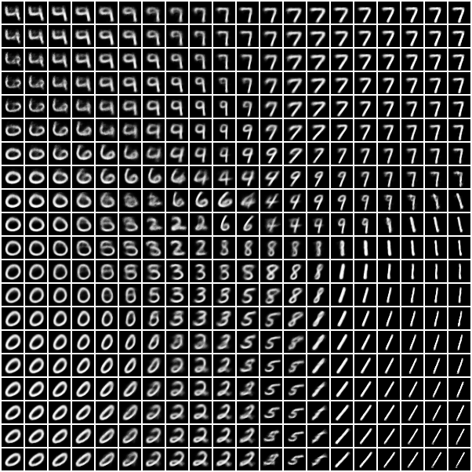
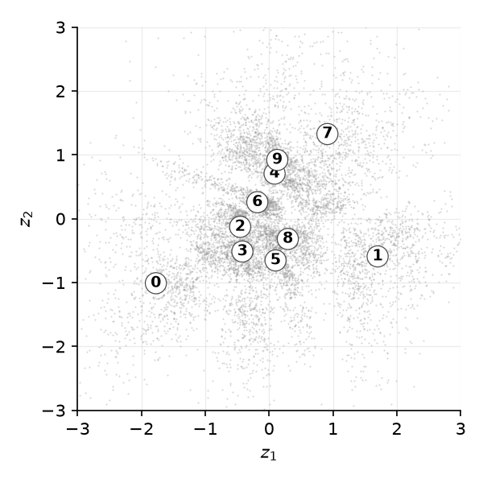
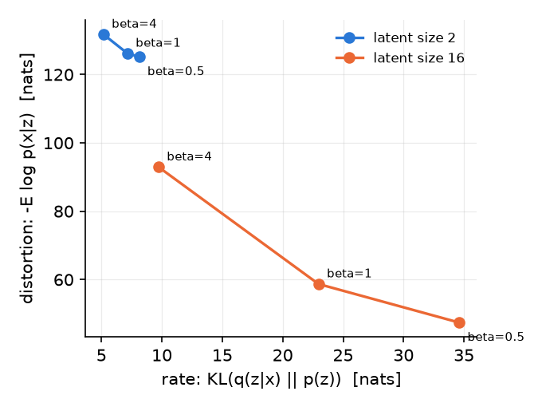
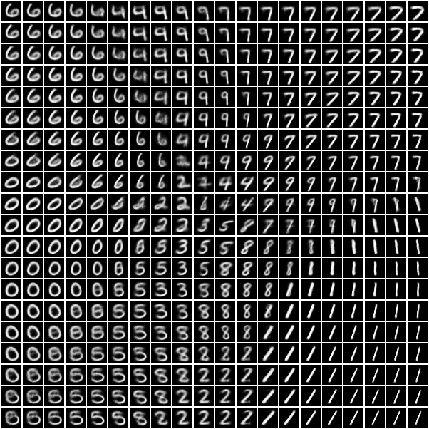
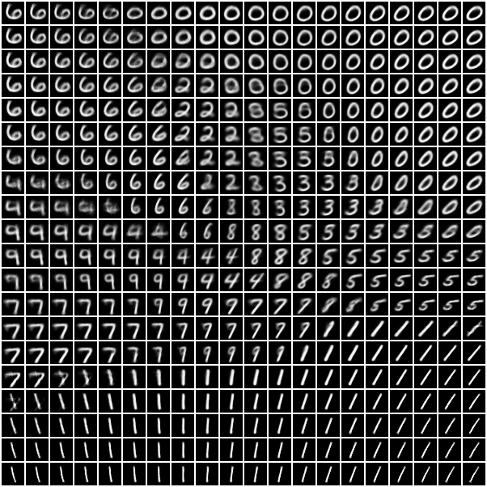
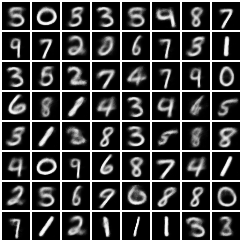
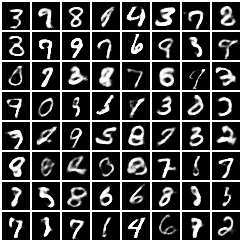
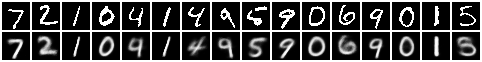
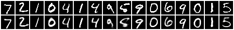
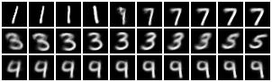

# 02 VAE

Learn a latent variable model $p(x) = \int p(x \mid z)\, p(z)\, dz$ of binarized MNIST digits,
together with an encoder $q(z \mid x)$ that maps an image to a distribution over latents.

## Math

**Model.** $p(z) = \mathcal N(0, I)$, $p(x \mid z) = \prod_i \mathrm{Bernoulli}(x_i;\, \sigma(\text{dec}(z))_i)$,
$q(z \mid x) = \mathcal N(\mu(x), \mathrm{diag}\, \sigma^2(x))$.

**ELBO.** For any $q$,

$$\log p(x) = \underbrace{\mathbb E_{q(z \mid x)}[\log p(x \mid z)] - \mathrm{KL}(q(z \mid x) \,\|\, p(z))}_{\mathrm{ELBO}(x)} + \mathrm{KL}(q(z \mid x) \,\|\, p(z \mid x))$$

The last KL is $\ge 0$, so the ELBO is a lower bound, and the gap is how far $q$ is from the true posterior.

**KL in closed form.** For a diagonal Gaussian against $\mathcal N(0, I)$:

$$\mathrm{KL} = \tfrac12 \sum_j \left(\mu_j^2 + \sigma_j^2 - \log \sigma_j^2 - 1\right)$$

Example: $\mu = 1, \sigma = 1$ in one dimension gives $\tfrac12(1 + 1 - 0 - 1) = 0.5$ nats.

**Reparameterisation.** $z = \mu + \sigma \odot \epsilon$, $\epsilon \sim \mathcal N(0, I)$.
The randomness moves into $\epsilon$, so gradients flow through $\mu$ and $\sigma$.

**Estimating $\log p(x)$.** Importance sampling with $q$ as proposal:

$$\log p(x) \approx \log \frac1k \sum_{j=1}^k \frac{p(x \mid z_j)\, p(z_j)}{q(z_j \mid x)}, \qquad z_j \sim q(z \mid x)$$

This is a lower bound that tightens as $k$ grows ($k = 1$ is the ELBO). We use $k = 500$.

**beta-VAE.** Minimise $D + \beta R$ with distortion $D = -\mathbb E_q[\log p(x \mid z)]$ and rate
$R = \mathrm{KL}(q(z \mid x) \,\|\, p(z))$. $\beta = 1$ is the negative ELBO; other $\beta$ pick another point on the
rate-distortion curve.

## Code map

| Math | Code |
|---|---|
| $\log p(x \mid z)$ for Bernoulli pixels | `objective.py: bernoulli_log_likelihood` |
| $\mathrm{KL}(\mathcal N(\mu, \sigma^2) \,\|\, \mathcal N(0, I))$ | `objective.py: gaussian_kl` |
| $D + \beta R$ | `objective.py: negative_elbo` |
| $\log \frac1k \sum_j p(x \mid z_j) p(z_j) / q(z_j \mid x)$ | `objective.py: importance_log_likelihood` |
| $z = \mu + \sigma \odot \epsilon$ | `model.py: VAE.reparameterize` |
| $q(z \mid x)$, $p(x \mid z)$ | `model.py: VAE.encode`, `VAE.decode` |

## Setup

| | |
|---|---|
| Data | MNIST thresholded at 0.5 (60k train, 10k test) |
| Networks | MLP encoder and decoder, 2 hidden layers of 512 |
| Latent size | 2 (to look at) and 16 |
| beta | 0.5, 1, 4 |
| Optimiser | Adam, lr 1e-3, batch 128, 30 epochs |
| Metrics | test reconstruction, KL, -ELBO, -log p(x) with $k = 500$, all in nats per image |

## Run

```
bash 02_vae/run.sh           # all runs
python 02_vae/figures.py     # figures and table
python 02_vae/train.py --z-dim 2 --beta 1    # a single run
```

## Checklist

- [x] 2-D latent: latent map, encoder means, interpolation
- [x] ELBO vs importance-sampled log p(x)
- [x] beta sweep: rate vs distortion

## Results

Test set, nats per image (lower is better).

| Latent size | beta | Reconstruction | KL | -ELBO | -log p(x) | Gap |
|---|---|---|---|---|---|---|
| 2 | 0.5 | 125.2 | 8.1 | 133.3 | 130.2 | 3.1 |
| 2 | 1 | 126.2 | 7.1 | 133.3 | 129.4 | 3.9 |
| 2 | 4 | 131.7 | 5.2 | 136.9 | 130.0 | 6.9 |
| 16 | 0.5 | 47.4 | 34.6 | 82.0 | 75.5 | 6.6 |
| 16 | 1 | 58.7 | 23.0 | 81.7 | 75.2 | 6.4 |
| 16 | 4 | 92.9 | 9.7 | 102.7 | 91.0 | 11.6 |

- **Latent size matters most.** 16 latents reach -log p(x) = 75.2 nats; 2 latents reach 129.4.
  With only 2 numbers per image, the decoder outputs blurry averages.
- **The ELBO is a loose bound.** It sits 3-12 nats below log p(x). The gap is KL(q(z|x) || p(z|x)), and it grows with
  beta (6.4 to 11.6 nats at 16 latents): a large beta pulls q towards the prior and away from the true posterior.
- **beta trades rate for distortion.** At 16 latents, beta 0.5 to 4 cuts the rate from 34.6 to 9.7 nats and raises the
  distortion from 47.4 to 92.9. beta = 1 gives the best -ELBO (81.7), as it should, since that is the quantity it optimises.
- **The 2-D latent space is organised by digit.** Moving across it changes the digit smoothly. Digits 4, 9 and 7 share
  one region, so an interpolation from a 4 to a 9 barely changes the image.

### Figures

**2-D latent space (beta = 1).** Left: decoded grid over $z \in [-2.5, 2.5]^2$. Right: encoder means of test images.

 

**Rate vs distortion**, and the 2-D latent map for beta = 0.5, 1, 4.



| beta = 0.5 | beta = 1 | beta = 4 |
|---|---|---|
|  |  |  |

**Samples from the prior** (pixel means), latent size 2 vs 16.

| Latent size 2 | Latent size 16 |
|---|---|
|  |  |

**Reconstructions** (top: input, bottom: output), latent size 2 and 16.





**Interpolation** between encoder means: 1 to 7, 3 to 8, 4 to 9 (latent size 2).


