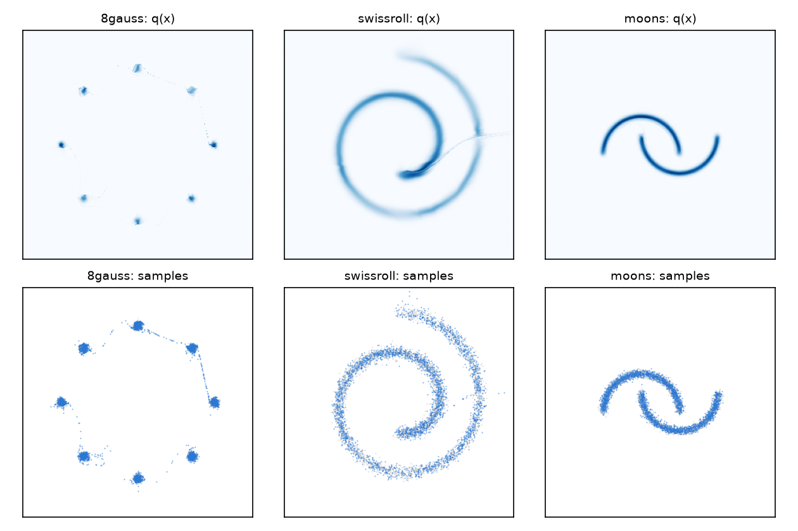
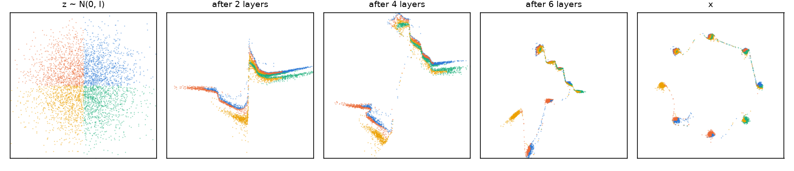

# 03 Normalizing flow

Learn an invertible map $f$ that turns data $x$ into Gaussian noise $z = f(x)$.
Because $f$ is invertible with a cheap Jacobian, the model gives exact densities and exact samples.

## Math

**Change of variables.** If $z = f(x)$ with $z \sim \mathcal N(0, I)$, then

$$\log q(x) = \log \mathcal N(f(x); 0, I) + \log \left| \det \frac{\partial f}{\partial x} \right|$$

Example in 1-D: $f(x) = 2x$ and $z \sim \mathcal N(0, 1)$ give $q(x) = \mathcal N(2x; 0, 1) \cdot 2$, which is $\mathcal N(0, 1/4)$.

**Affine coupling.** Split $x = (x_a, x_b)$ and keep $x_a$:

$$z_a = x_a, \qquad z_b = x_b \odot e^{s(x_a)} + t(x_a)$$

The Jacobian is triangular, so $\log |\det| = \sum s(x_a)$, and the inverse $x_b = (z_b - t(z_a)) \odot e^{-s(z_a)}$
needs no inversion of $s$ or $t$. These can be any networks. Layers alternate which half is kept.

**Maximum likelihood = forward KL.**

$$\mathrm{KL}(p \,\|\, q) = \mathbb E_p[\log p(x)] - \mathbb E_p[\log q(x)]$$

The first term does not depend on $q$, so maximising the data log-likelihood minimises $\mathrm{KL}(p \,\|\, q)$.
This KL is large wherever $p > 0$ but $q \approx 0$, so the fit is mode-covering: it would rather put some mass between
modes than miss one. For 8 Gaussians we know $\log p$ exactly, so the KL can be measured.

## Code map

| Math | Code |
|---|---|
| $z_b = x_b \odot e^{s(x_a)} + t(x_a)$, $\log\lvert\det\rvert = \sum s$ | `model.py: AffineCoupling.forward` |
| $x_b = (z_b - t(z_a)) \odot e^{-s(z_a)}$ | `model.py: AffineCoupling.inverse` |
| $\log q(x) = \log \mathcal N(f(x)) + \log\lvert\det\rvert$ | `objective.py: log_prob` |
| $-\mathbb E_p[\log q(x)]$ | `objective.py: nll` |
| $x = f^{-1}(z)$, $z \sim \mathcal N(0, I)$ | `sample.py: sample` |
| $\mathbb E_p[\log p - \log q]$ | `sample.py: evaluate` |

## Setup

| | |
|---|---|
| Data | 8 Gaussians, swiss roll, two moons (fresh samples every step) |
| Flow | 8 affine coupling layers; $s, t$ from an MLP with 3 hidden layers of 256; $s$ bounded by tanh |
| Optimiser | Adam, lr 5e-4 with cosine decay, batch 512, 10k steps |
| Metrics | test NLL on 100k fresh samples (nats); for 8 Gaussians also the true NLL and $\mathrm{KL}(p \,\|\, q)$ |

## Run

```
bash 03_flow/run.sh          # all runs
python 03_flow/figures.py    # figures and table
python 03_flow/train.py --data 8gauss    # a single run
```

## Checklist

- [x] Fit 8 Gaussians, swiss roll and two moons; density maps and samples
- [x] Measure KL(p || q) on 8 Gaussians
- [x] Show how the layers warp the Gaussian

## Results

Test NLL on 100k fresh samples, nats per point (lower is better; it can be negative for a density).

| Data | Test NLL | True NLL | KL(p \|\| q) |
|---|---|---|---|
| 8 Gaussians | -0.859 | -1.074 | 0.215 |
| swiss roll | 1.592 | - | - |
| two moons | 0.295 | - | - |

- **All 8 modes are covered.** KL(p || q) = 0.215 nats: close to the data, but not exact.
  Compare 01_gan, where the non-saturating GAN covered 4 of 8.
- **The fit is mode-covering, with thin bridges.** Density leaks along thin threads between neighbouring Gaussians,
  and one thread leaves the swiss roll. Part of this is forced: $f^{-1}$ is continuous and $\mathbb R^2$ is connected,
  so the samples $f^{-1}(z)$ cannot form truly separate islands. Forward KL then prefers thin bridges over dropping a mode.
- **The layers cut and fold the Gaussian.** Each coupling stretches one coordinate as a function of the other.
  After 8 layers the four quadrants of $z$ are spread over several modes (figure below).

### Figures

**Learned density and samples** (blue: flow samples, grey: data).



**Gaussian samples pushed through the flow**, coloured by the quadrant of $z$ they start in.


