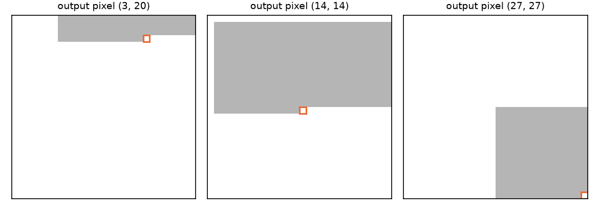
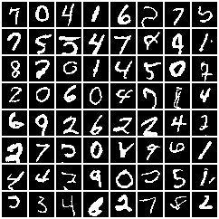
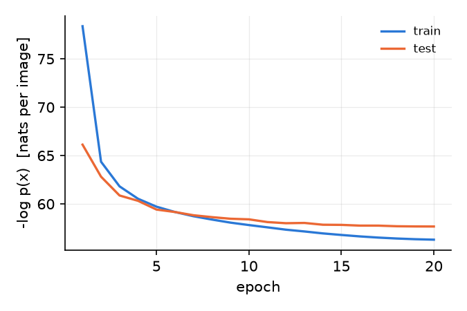

# 04 Autoregressive model

Model binarized MNIST digits pixel by pixel. The probability of an image is a product of 784 conditionals,
each predicted by a network that only sees the pixels before it.

## Math

**Chain rule.** Order the pixels row by row. Then, exactly,

$$p(x) = \prod_{i=1}^{784} p(x_i \mid x_1, \dots, x_{i-1}), \qquad \log p(x) = \sum_i \log p(x_i \mid x_{<i})$$

Example with 2 pixels: if $p(x_1 = 1) = 0.2$ and $p(x_2 = 1 \mid x_1 = 1) = 0.9$, then $p(1, 1) = 0.2 \times 0.9 = 0.18$.

No latent variables and no bound: the log-likelihood is exact, and training is maximum likelihood.

**Masked convolutions.** One forward pass outputs all 784 conditionals, so training is parallel.
This works only if output $i$ never sees input $i$ or later inputs. Zeroing part of each kernel enforces this.
A single masked stack misses some pixels above and to the right (the blind spot); the gated PixelCNN avoids it with two stacks:

- vertical stack at $(i, j)$: all pixels in rows above $i$
- horizontal stack at $(i, j)$: pixels left of $j$ in row $i$, plus the vertical stack

Each layer uses a gated unit $\tanh(a) \odot \sigma(b)$.

**Sampling is sequential.** $x_i \sim p(x_i \mid x_{<i})$ needs the pixels before it, so drawing one image takes 784 forward passes.

**Units.** Bits per pixel $= \dfrac{-\log p(x)}{784 \ln 2}$.

## Code map

| Math | Code |
|---|---|
| $-\sum_i \log p(x_i \mid x_{<i})$ | `objective.py: nll_per_image` |
| kernel masks (rows above / pixels to the left) | `model.py: vertical_mask`, `horizontal_mask` |
| masked convolution | `model.py: MaskedConv2d` |
| $\tanh(a) \odot \sigma(b)$, vertical feeds horizontal | `model.py: GatedLayer` |
| $x_i \sim p(x_i \mid x_{<i})$ in raster order | `sample.py: sample` |
| output $i$ depends only on $x_{<i}$ | `sample.py: check_causality`, `dependency_map` |

## Setup

| | |
|---|---|
| Data | MNIST thresholded at 0.5 (same as 02_vae) |
| Network | Gated PixelCNN, 64 channels, 7 gated layers with dilations 1, 2, 1, 4, 1, 2, 1 |
| Optimiser | Adam, lr 1e-3 with cosine decay, batch 128, 20 epochs |
| Metrics | exact test -log p(x) in nats, bits per pixel, time to draw 64 samples on one GPU |

## Run

```
bash 04_autoregressive/run.sh          # train, then sample
python 04_autoregressive/figures.py    # figures and table
```

## Checklist

- [x] Exact test log-likelihood, compared with the VAE
- [x] Check that each output sees only earlier pixels
- [x] Sampling time

## Results

| Test -log p(x) | Bits per pixel | Parameters | Time for 64 samples |
|---|---|---|---|
| 57.66 nats | 0.1061 | 0.84 M | 7.1 s |

- **Exact likelihood beats the VAE bound by a wide margin.** 57.7 nats against 75.2 for the 16-latent VAE in 02
  (same data). The VAE number is itself an estimate from 500 importance samples; this one is exact.
- **Each output sees only earlier pixels.** The gradient of output $(i, j)$ is zero at $(i, j)$ and at every later
  pixel (checked before training and shown below). The window is finite: about 14 rows up and 14 columns to each side,
  so the last pixel never sees the top of the image.
- **Sampling is the price.** 784 full forward passes give 64 digits in 7.1 s; one training pass scores all
  784 conditionals at once. The digits are clean locally, with some broken strokes, a sign of the limited window.

### Figures

**What each output depends on.** Grey: input pixels with a non-zero gradient for the outlined output pixel.



**Samples** (64 digits, drawn pixel by pixel) and the training curve.

 
