# 06 DDPM

Turn data into noise with a fixed process, then learn to undo it one small step at a time.
The network only has to predict the noise that was added.

## Math

**Forward process.** With a schedule $\beta_1, \dots, \beta_T$ and $\alpha_t = 1 - \beta_t$:

$$q(x_t \mid x_{t-1}) = \mathcal N\!\left(\sqrt{\alpha_t}\, x_{t-1},\ \beta_t I\right)$$

Composing Gaussians gives a closed form for any $t$, with $\bar\alpha_t = \prod_{s \le t} \alpha_s$:

$$x_t = \sqrt{\bar\alpha_t}\, x_0 + \sqrt{1 - \bar\alpha_t}\, \epsilon, \qquad \epsilon \sim \mathcal N(0, I)$$

Example: $T = 2$, $\beta_1 = \beta_2 = 0.5$ gives $\bar\alpha_2 = 0.25$, so $x_2 = 0.5\, x_0 + \sqrt{0.75}\, \epsilon$.
With $T = 1000$ and $\beta$ from $10^{-4}$ to $0.02$, $\bar\alpha_T \approx 4 \times 10^{-5}$: $x_T$ is almost pure noise.

**Reverse step.** Given $x_0$, the step back is Gaussian too: $q(x_{t-1} \mid x_t, x_0) = \mathcal N(\tilde\mu_t, \tilde\beta_t I)$.
Writing $x_0$ through the noise, $x_0 = (x_t - \sqrt{1 - \bar\alpha_t}\, \epsilon) / \sqrt{\bar\alpha_t}$, the mean becomes

$$\tilde\mu_t = \frac{1}{\sqrt{\alpha_t}}\left(x_t - \frac{\beta_t}{\sqrt{1 - \bar\alpha_t}}\, \epsilon\right)$$

So the model $p_\theta(x_{t-1} \mid x_t)$ only needs a noise estimate $\epsilon_\theta(x_t, t)$.

**Loss.** The ELBO is a sum of KLs between these Gaussians; each is a weighted $\lVert \epsilon - \epsilon_\theta \rVert^2$.
Dropping the weights gives the simple loss

$$L = \mathbb E_{t, x_0, \epsilon} \left\lVert \epsilon - \epsilon_\theta\!\left(\sqrt{\bar\alpha_t}\, x_0 + \sqrt{1 - \bar\alpha_t}\, \epsilon,\ t\right) \right\rVert^2$$

**Link to scores.** $\epsilon_\theta(x_t, t) \approx -\sqrt{1 - \bar\alpha_t}\, \nabla_x \log p_t(x_t)$: predicting noise is
estimating the score of the noised data.

**DDIM.** A deterministic map with the same marginals $q(x_t \mid x_0)$. From $x_t$, estimate
$\hat x_0 = (x_t - \sqrt{1 - \bar\alpha_t}\, \epsilon_\theta) / \sqrt{\bar\alpha_t}$, then jump to any earlier time $s$:
$x_s = \sqrt{\bar\alpha_s}\, \hat x_0 + \sqrt{1 - \bar\alpha_s}\, \epsilon_\theta$. This allows far fewer than $T$ steps.

**Classifier-free guidance.** Train one network with labels, replacing 10 % of them by "no label". At sampling time

$$\tilde\epsilon = (1 + w)\, \epsilon_\theta(x_t, t, y) - w\, \epsilon_\theta(x_t, t, \varnothing)$$

In score terms this follows $\nabla \log p(x \mid y) + w\, \nabla \log p(y \mid x)$: the label is pushed harder as $w$ grows.

## Code map

| Math | Code |
|---|---|
| $\beta_t$, $\alpha_t$, $\bar\alpha_t$ | `objective.py: NoiseSchedule` |
| $x_t = \sqrt{\bar\alpha_t}\, x_0 + \sqrt{1 - \bar\alpha_t}\, \epsilon$ | `objective.py: q_sample` |
| $\lVert \epsilon - \epsilon_\theta(x_t, t) \rVert^2$ | `objective.py: ddpm_loss` |
| $x_{t-1} = \tilde\mu_t(x_t, \epsilon_\theta) + \sqrt{\beta_t}\, z$ | `sample.py: ddpm_sample` |
| $\hat x_0$, then $x_s$ | `sample.py: ddim_sample` |
| $(1 + w)\, \epsilon(x, y) - w\, \epsilon(x, \varnothing)$ | `sample.py: predict_eps` |
| $\epsilon_\theta$ | `model.py: ToyDenoiser`, `ImageDenoiser` (shared U-Net in `common/nets.py`) |

## Setup

| | 2-D | Fashion-MNIST |
|---|---|---|
| Data | swiss roll, 8 Gaussians | 60k train images, 28 x 28, labels dropped 10 % of the time |
| Network | MLP, 3 hidden layers of 256, sinusoidal time embedding | U-Net, 6.5 M parameters, 28 -> 14 -> 7, attention at 7 x 7 |
| Schedule | $T = 1000$, linear $\beta$ from $10^{-4}$ to $0.02$ | same |
| Optimiser | Adam, lr 1e-3, batch 512, 20k steps | Adam, lr 2e-4, batch 128, 30k steps |
| Weights used for sampling | EMA, decay 0.999 | same |
| Metrics | modes covered (8 Gaussians, 5000 samples) | FID-lite, class balance, label accuracy (2000 samples) |

## Run

```
bash 06_ddpm/run.sh          # train, then the sampler and guidance sweeps
python 06_ddpm/figures.py    # figures and tables
```

## Checklist

- [x] 2-D: swiss roll and 8 Gaussians
- [x] Fashion-MNIST: DDPM with 1000 steps vs DDIM with 10, 50, 100, 1000 steps
- [x] Classifier-free guidance, w from 0 to 4

## Results

**8 Gaussians** (5000 samples).

| Sampler | Steps | Modes covered | High-quality samples |
|---|---|---|---|
| DDPM | 1000 | 8 | 0.94 |
| DDIM | 10 | 8 | 0.72 |
| DDIM | 50 | 8 | 0.95 |
| DDIM | 100 | 8 | 0.95 |
| DDIM | 1000 | 8 | 0.94 |

**Fashion-MNIST, samplers** (2000 unconditional samples, using the "no label" input; 2000 real training images score
2.4 here, the floor at this sample size).

| Sampler | Steps | FID-lite | Class KL | Rarest class share | Seconds per 1k samples |
|---|---|---|---|---|---|
| DDPM | 1000 | 7.1 | 0.027 | 0.070 | 344 |
| DDIM | 10 | 26.0 | 0.035 | 0.055 | 3 |
| DDIM | 50 | 7.2 | 0.024 | 0.072 | 17 |
| DDIM | 100 | 6.2 | 0.025 | 0.072 | 34 |
| DDIM | 1000 | 5.5 | 0.023 | 0.074 | 225 |

**Fashion-MNIST, guidance** (DDIM, 50 steps, labels 0-9 in turn).

| w | FID-lite | Label accuracy | Class KL |
|---|---|---|---|
| 0 | 3.7 | 0.890 | 0.003 |
| 0.5 | 9.2 | 0.960 | 0.001 |
| 1 | 16.1 | 0.983 | 0.000 |
| 2 | 27.5 | 0.994 | 0.000 |
| 4 | 42.4 | 1.000 | 0.000 |

- **No mode collapse.** All 8 Gaussians are covered by every sampler, and Fashion-MNIST classes stay balanced
  (compare the non-saturating GAN in 01, which kept 4 of 8).
- **DDIM with 50 steps matches DDPM with 1000**, at about 1/20 of the time (FID-lite 7.2 vs 7.1).
  With all 1000 steps the deterministic DDIM is better still (5.5).
- **Too few steps blur the structure.** With 10 steps FID-lite rises to 26, and on 8 Gaussians the samples spread
  along the straight edges between neighbouring modes.
- **DDIM is a fixed map from noise to images.** From the same noise, 10 and 50 steps give the same items (grids below);
  ancestral DDPM adds fresh noise at every step and gives different ones.
- **Guidance trades variety for label fidelity.** As $w$ goes from 0 to 4, label accuracy rises from 89 % to 100 %
  while FID-lite rises from 3.7 to 42: samples get more typical of their class and less varied.
  Plain conditional sampling ($w = 0$) scores 3.7, better than unconditional (7.2), close to the 2.4 floor.

### Figures

**Forward process:** swiss roll and one Fashion-MNIST image at $t$ = 1, 51, 151, 301, 601, 1000.

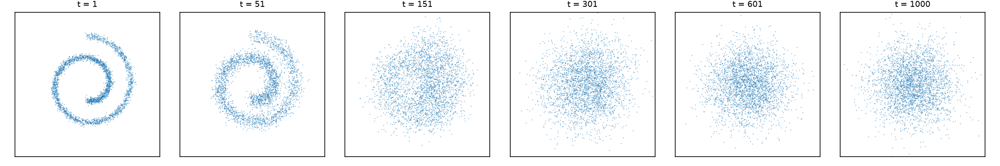

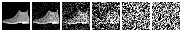

**2-D samples** by sampler: swiss roll (top), 8 Gaussians (bottom).

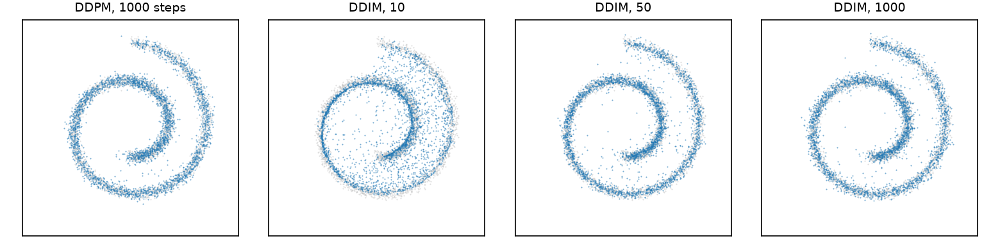

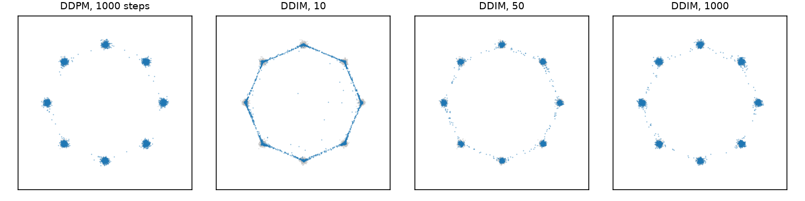

**Fashion-MNIST: steps and guidance.**

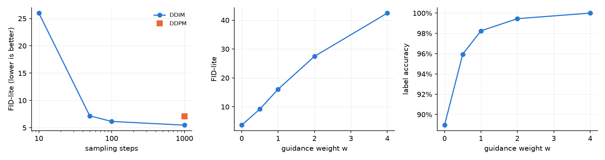

**Unconditional samples:** DDIM 10 steps, DDIM 50 steps (same noise), DDPM 1000 steps.

| DDIM, 10 | DDIM, 50 | DDPM, 1000 |
|---|---|---|
| 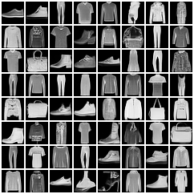 | 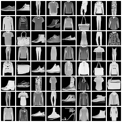 | 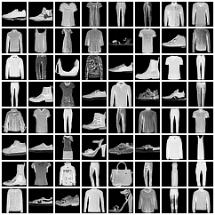 |

**Guided samples** (column $j$ = class $j$), $w$ = 0, 1, 4.

| w = 0 | w = 1 | w = 4 |
|---|---|---|
| 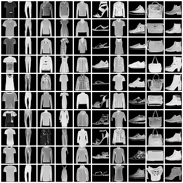 | 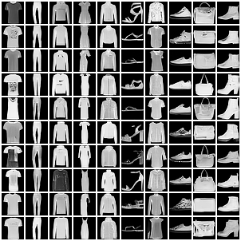 | 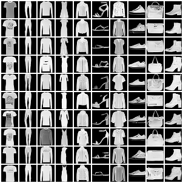 |
