# 07 Flow matching

Learn a velocity field that carries Gaussian noise to data along (nearly) straight paths,
then generate by solving an ODE with a handful of steps. Same U-Net and data as 06.

## Math

**Straight paths.** Pair noise $x_0 \sim \mathcal N(0, I)$ with data $x_1$ and interpolate

$$x_t = (1 - t)\, x_0 + t\, x_1, \qquad \frac{d x_t}{dt} = x_1 - x_0, \qquad t \in [0, 1]$$

**Marginal velocity.** Many pairs pass through the same point $x$ at time $t$. Their average direction

$$v^*(x, t) = \mathbb E[\, x_1 - x_0 \mid x_t = x \,]$$

moves the whole distribution $p_t$ along the path (it satisfies the continuity equation
$\partial_t p_t + \nabla \cdot (p_t v^*) = 0$). Following $dx/dt = v^*(x, t)$ from noise at $t = 0$ ends at the data at $t = 1$.

**Loss.** $v^*$ is unknown, but regressing on the per-pair velocity gives the same minimiser, because
$\mathbb E \lVert v - (x_1 - x_0) \rVert^2 = \mathbb E \lVert v - v^* \rVert^2 + \text{const}$:

$$L = \mathbb E_{t, x_0, x_1} \left\lVert v_\theta(x_t, t) - (x_1 - x_0) \right\rVert^2$$

**Sampling.** Euler steps $x \leftarrow x + v_\theta(x, t)\, \Delta t$ with $\Delta t = 1/K$.

**Why paths bend, and reflow.** Example in 1-D with a single data point $x_1 = 3$: $v^*(x, t) = (3 - x)/(1 - t)$,
every path is a straight line to 3, and one Euler step from $t = 0$ lands exactly on 3.
With many data points, independent pairs cross, $v^*$ averages the crossing directions, and the paths curve,
so one step is no longer enough. Reflow retrains on pairs $(x_0, \mathrm{ODE}(x_0))$ produced by the first model.
These pairs do not cross, so the new paths are straighter.

**Straightness**, as measured here: the mean distance between the 1-step and the 100-step endpoints from the same noise.
It is 0 for straight paths travelled at constant speed.

**Classifier-free guidance** works as in 06, on the velocity: $\tilde v = (1 + w)\, v_\theta(x, t, y) - w\, v_\theta(x, t, \varnothing)$.

## Code map

| Math | Code |
|---|---|
| $x_t = (1 - t)\, x_0 + t\, x_1$ | `objective.py: interpolate` |
| $\lVert v_\theta(x_t, t) - (x_1 - x_0) \rVert^2$ | `objective.py: flow_matching_loss` |
| $x \leftarrow x + v_\theta(x, t) / K$ | `sample.py: euler_sample` |
| $(1 + w)\, v(x, y) - w\, v(x, \varnothing)$ | `sample.py: velocity` |
| 1-step vs 100-step endpoint distance | `sample.py: straightness` |
| pairs $(x_0, \mathrm{ODE}(x_0))$ for reflow | `train.py: reflow_pairs` |
| $v_\theta$ | `model.py: ToyVelocity`, `ImageVelocity` (shared U-Net in `common/nets.py`) |

## Setup

As in 06: same networks (time $t \in [0, 1]$ scaled by 1000 before the sinusoidal embedding), optimiser, EMA,
label dropout and metrics.

| | 2-D | Fashion-MNIST |
|---|---|---|
| Data | 8 Gaussians, swiss roll | 60k train images, labels dropped 10 % of the time |
| Training | 20k steps, batch 512, lr 1e-3 | 30k steps, batch 128, lr 2e-4 |
| Reflow | 8 Gaussians: 100k pairs from the first model (100 Euler steps), then 20k steps | - |
| Sampling | Euler, 1 to 100 steps | Euler, 1 to 100 steps |

## Run

```
bash 07_flow_matching/run.sh          # train, then the step and guidance sweeps
python 07_flow_matching/figures.py    # figures and tables
```

## Checklist

- [x] 2-D: 8 Gaussians and swiss roll, quality vs number of steps
- [x] Reflow on 8 Gaussians: straighter paths, fewer steps
- [x] Fashion-MNIST: quality vs number of steps, against DDIM from 06
- [x] Classifier-free guidance

## Results

**8 Gaussians** (5000 samples). Cells: modes covered (of 8) / share of high-quality samples.

| Model | Straightness | 1 step | 2 | 5 | 10 | 20 | 100 |
|---|---|---|---|---|---|---|---|
| flow matching | 1.96 | 0 / 0.00 | 0 / 0.00 | 8 / 0.78 | 8 / 0.93 | 8 / 0.96 | 8 / 0.96 |
| after reflow | 0.05 | 8 / 0.86 | 8 / 0.87 | 8 / 0.89 | 8 / 0.91 | 8 / 0.92 | 8 / 0.93 |

**Fashion-MNIST, steps** (2000 unconditional samples; real images score 2.4 at this size; straightness 14.9).

| Steps | Flow matching FID-lite | DDIM from 06 | Seconds per 1k (flow matching) |
|---|---|---|---|
| 1 | 698.8 | - | 0.2 |
| 2 | 403.7 | - | 0.3 |
| 5 | 66.6 | - | 0.8 |
| 10 | 22.4 | 26.0 | 1.6 |
| 20 | 11.1 | - | 3.2 |
| 50 | 6.8 | 7.2 | 8.0 |
| 100 | 6.1 | 6.2 | 16.0 |

**Fashion-MNIST, guidance** (50 Euler steps).

| w | FID-lite | Label accuracy |
|---|---|---|
| 0 | 3.5 | 0.909 |
| 0.5 | 10.7 | 0.967 |
| 1 | 19.4 | 0.987 |
| 2 | 35.3 | 0.998 |
| 4 | 61.2 | 1.000 |

- **One step lands on the mean.** At $t = 0$, $x_t = x_0$ is pure noise and says nothing about the data, so
  $v^*(x, 0) = \mathbb E[x_1] - x$, and one Euler step sends every sample to $\mathbb E[x_1]$: the centre of the ring,
  or the average image (FID-lite 699). About 5 steps are needed on 8 Gaussians and 20-50 on Fashion-MNIST.
- **Reflow straightens the paths.** Straightness drops from 1.96 to 0.05, and a single step now covers all 8 modes
  (86 % high-quality samples). The price: with many steps it is slightly worse (0.93 vs 0.96), because it learns the
  first model's mistakes along with its pairing.
- **Flow matching and DDIM are on par.** At 10, 50 and 100 steps, FID-lite is 22.4 / 6.8 / 6.1 against 26.0 / 7.2 / 6.2.
- **Same noise, same image.** From the same starting noise, the DDIM sampler of 06 and the Euler sampler here give
  nearly the same images (mean L2 distance 4.2, against 21.1 for random pairs; figure below), although the two networks
  were trained separately with different losses. Both training paths have the form $x_t = a_t\, x_1 + b_t\, x_0$
  (DDPM: $a = \sqrt{\bar\alpha_t}$, $b = \sqrt{1 - \bar\alpha_t}$; here: $a = t$, $b = 1 - t$). Divided by $b_t$,
  $x_t / b_t = (a_t / b_t)\, x_1 + x_0$ depends only on the ratio $a_t / b_t$, so both deterministic samplers follow
  the same ODE with a different clock. Ideal models therefore map each noise sample to the same image.
- **Guidance behaves as in 06.** Label accuracy rises from 91 % to 100 % as FID-lite rises from 3.5 to 61.

### Figures

**Sampling paths from the same noise** (100 Euler steps), before and after reflow.

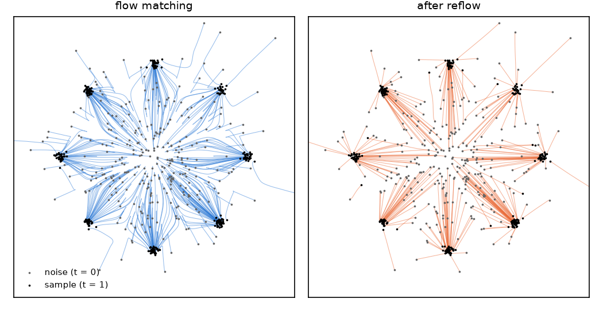

**8 Gaussians by number of Euler steps:** flow matching (top), after reflow (bottom).

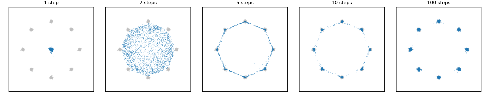

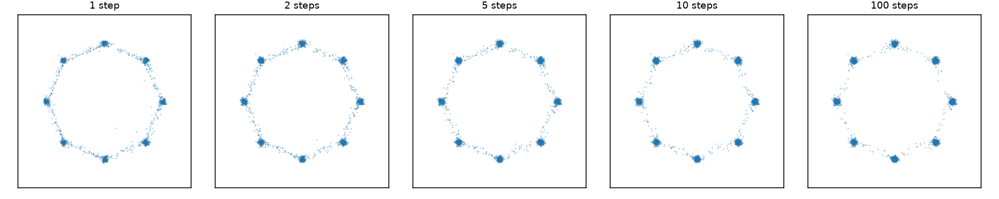

**Swiss roll by number of Euler steps.**

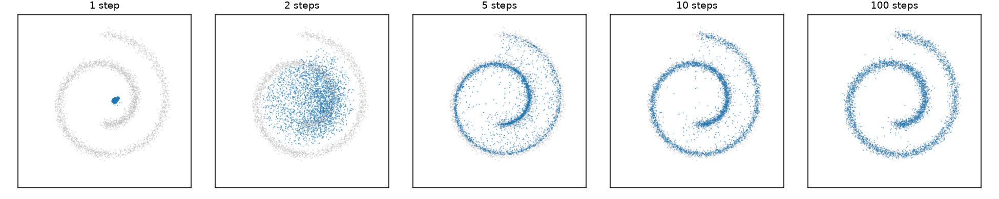

**Fashion-MNIST: quality vs steps** (with DDIM from 06) **and label accuracy vs guidance.**

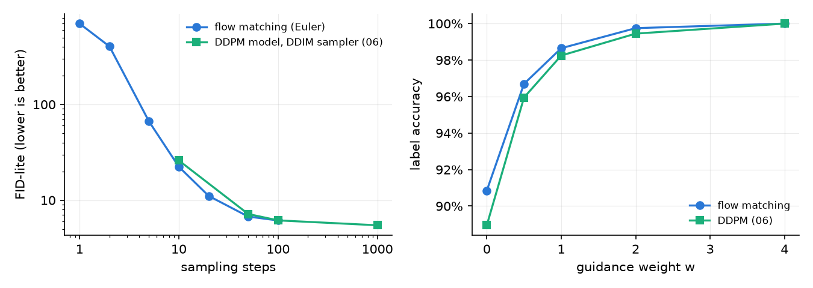

**Same noise, two models:** DDIM, 50 steps, from 06 (top) and flow matching, 50 Euler steps (bottom).

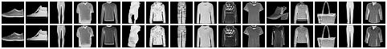

**Fashion-MNIST samples** with 1, 5, 10 and 50 Euler steps (unconditional).

| 1 step | 5 | 10 | 50 |
|---|---|---|---|
| 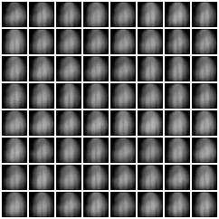 | 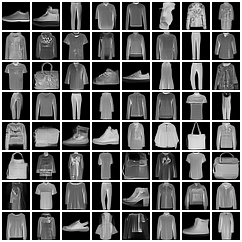 | 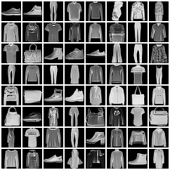 | 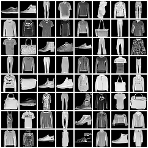 |

**Guided samples** (column $j$ = class $j$), $w$ = 0, 1, 4.

| w = 0 | w = 1 | w = 4 |
|---|---|---|
| 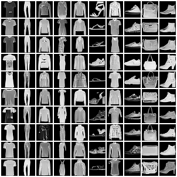 | 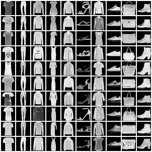 | 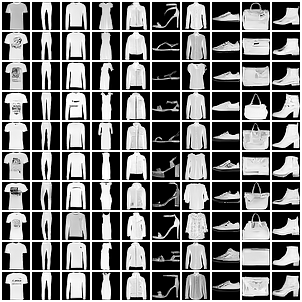 |
