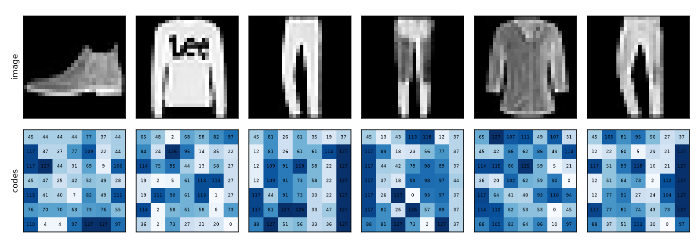
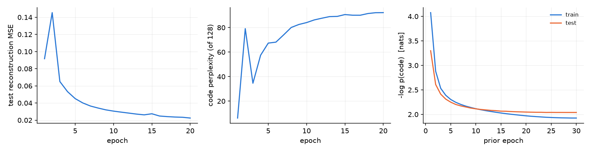
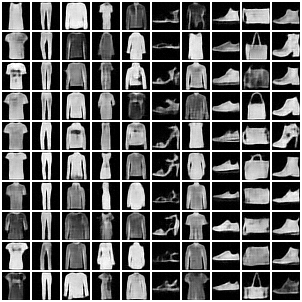
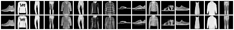

# 08 VQ-VAE with a transformer prior

Two stages. A VQ-VAE compresses each Fashion-MNIST image into a 7 x 7 grid of discrete codes;
a transformer then learns which code grids are likely, one code at a time. Sampling draws a code grid
from the transformer and decodes it.

## Math

**Quantisation.** The encoder gives a vector $z_e$ at each of the 7 x 7 positions. Each is replaced by its nearest
codebook entry:

$$k = \arg\min_j \lVert z_e - e_j \rVert^2, \qquad z_q = e_k$$

**Straight-through gradient.** $\arg\min$ has no gradient, so the forward pass uses $e_k$ and the backward pass copies
the gradient of $z_q$ onto $z_e$: in code, $z_q = z_e + \mathrm{sg}(e_k - z_e)$, where sg stops gradients.

**Loss.**

$$L = \lVert x - \mathrm{dec}(z_q) \rVert^2 + \lVert \mathrm{sg}(z_e) - e_k \rVert^2 + \beta\, \lVert z_e - \mathrm{sg}(e_k) \rVert^2$$

reconstruction; codebook term (moves the code towards the encoder output); commitment term (keeps the encoder near
its code), with $\beta = 0.25$.

**Link to the VAE (02).** The posterior $q(z \mid x)$ puts all its mass on one code per position. With a uniform prior
over $K$ codes, the KL term is the constant $\log K$ per position, so it drops out of training.
The prior is learned afterwards instead.

**Prior.** Over the 49 codes in raster order, conditioned on the class $y$, by the chain rule (as in 04):

$$\log p(c \mid y) = \sum_{t=1}^{49} \log p(c_t \mid y, c_{<t})$$

**Compression.** One image becomes $49 \log_2 128 = 343$ bits as codes. A good prior needs fewer bits on average:
$-\log_2 p(c \mid y)$.

**Codebook usage.** Perplexity $= \exp(H)$ of the code histogram: the effective number of codes in use.
Unused codes are restarted at random encoder outputs after each epoch.

## Code map

| Math | Code |
|---|---|
| $k = \arg\min_j \lVert z_e - e_j \rVert^2$ | `model.py: VectorQuantizer.indices` |
| $z_q = z_e + \mathrm{sg}(e_k - z_e)$ | `model.py: VectorQuantizer.forward` |
| reconstruction + codebook + $\beta$ commitment | `objective.py: vqvae_loss` |
| $-\sum_t \log p(c_t \mid y, c_{<t})$ | `objective.py: prior_nll` |
| $\exp(H)$ of code usage | `objective.py: perplexity` |
| restart unused codes | `train.py: train_vqvae` |
| $c_t \sim p(c_t \mid y, c_{<t})$, then decode | `sample.py: sample_codes`, `model.py: VQVAE.decode` |

## Setup

| | |
|---|---|
| Data | Fashion-MNIST, images in [-1, 1] |
| VQ-VAE | conv encoder 28 -> 14 -> 7 with residual blocks; 128 codes of dimension 64; Adam, lr 2e-4, batch 128, 20 epochs |
| Prior | 6 transformer blocks, width 256, 8 heads, class token first; AdamW, lr 3e-4 (one-cycle), batch 256, 30 epochs |
| Metrics | test MSE and PSNR, code usage, prior NLL, FID-lite and label accuracy of samples (2000 images) |

## Run

```
bash 08_vqvae_prior/run.sh          # VQ-VAE, then prior, then sampling
python 08_vqvae_prior/figures.py    # figures and tables
```

## Checklist

- [x] VQ-VAE: reconstructions and code usage
- [x] Transformer prior over codes, class-conditional
- [x] Samples: quality, label accuracy and sampling time

## Results

| VQ-VAE | Value |
|---|---|
| Test MSE / PSNR | 0.0225 / 22.5 dB |
| Codes used / perplexity (of 128) | 128 / 92.2 |
| One image as codes | 49 x log2(128) = 343 bits |
| Parameters | 1.16 M |

| Prior | Value |
|---|---|
| Test -log p(code) | 2.04 nats per code |
| Test -log p(codes) per image | 144 bits (343 for uniform codes) |
| Parameters | 4.82 M |

| Images (2000) | FID-lite | Class KL | Label accuracy |
|---|---|---|---|
| Reconstructions | 19.0 | 0.011 | - |
| Prior samples, class-conditional | 20.8 | 0.010 | 0.88 |

Sampling takes 5.4 s per 1000 images: 49 prior steps and one decoder pass (the PixelCNN in 04 needs 784 passes).

- **Without restarts the codebook collapses.** After epoch 1 only 21 codes were in use (perplexity 6).
  Restarting unused codes revived 82 of them at epoch 2 (with a brief jump in reconstruction error), and by the end all
  128 are used (perplexity 92).
- **A few codes paint the background.** The same handful of codes fills the border of almost every image
  (see the code maps below), so the prior predicts them almost for free.
- **The prior compresses the codes by 58 %.** 144 bits per image instead of 343. It starts to overfit after
  about 12 epochs (train NLL keeps falling, test NLL flattens).
- **Samples are almost as good as reconstructions.** FID-lite 20.8 against 19.0, the limit set by the decoder;
  88 % of samples show the requested class. For comparison, the WGAN-GP in 01 reached 14.8 and the conditional GAN 56.6.

### Figures

**Images and their 7 x 7 code grids.**



**Training:** reconstruction error, code usage and prior NLL.



**Prior samples** (column $j$ = class $j$) and **reconstructions** (top: input, bottom: output).




