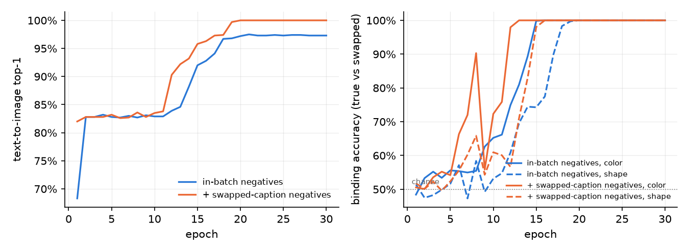
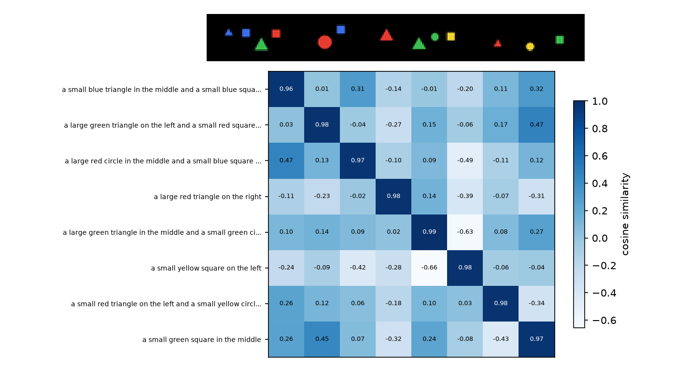
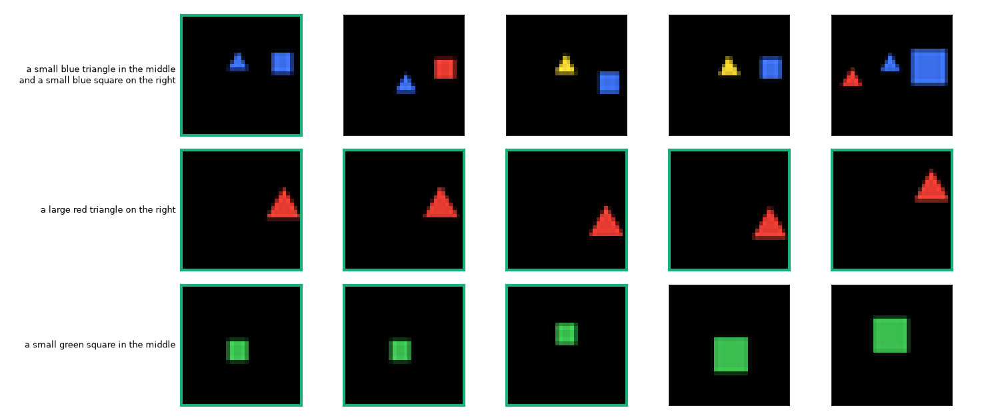

# 09a CLIP

Learn one embedding space for images and captions, so that a picture and its description land close together.
Data: synthetic scenes of 1-3 colored shapes with generated captions (`common/shapes.py`).

## Math

**Two encoders.** An image encoder $f$ and a text encoder $g$, each followed by a projection, give unit vectors
$u_i = f(x_i) / \lVert f(x_i) \rVert$ and $v_j = g(t_j) / \lVert g(t_j) \rVert$.

**Contrastive loss (InfoNCE).** In a batch of $B$ pairs, each image must find its own caption, and each caption its own image:

$$L = -\frac{1}{2B} \sum_{i=1}^{B} \left[ \log \frac{e^{u_i \cdot v_i / \tau}}{\sum_j e^{u_i \cdot v_j / \tau}} + \log \frac{e^{u_i \cdot v_i / \tau}}{\sum_j e^{u_j \cdot v_i / \tau}} \right]$$

This is cross-entropy over "which of the $B$ captions is mine?". The temperature $\tau$ is learned.

**Mutual information.** InfoNCE gives a lower bound $I(X; T) \ge \log B - L$.
Example: $B = 4$ and the right caption gets probability 0.97, so $L = -\log 0.97 \approx 0.03$ and the bound is
$\log 4 - 0.03 \approx 1.36$ nats.

**Zero-shot recognition.** Score an image against every candidate caption and take the best one.
No classifier is trained.

**Binding.** "a red circle and a blue square" and "a blue circle and a red square" use the same words.
A model that only knows which words appear (a bag of words) scores both the same and is right 50 % of the time.
**Hard negatives** add such swapped captions to the denominator, so the image must rank them below its own caption.

## Code map

| Math | Code |
|---|---|
| $u = f(x) / \lVert f(x) \rVert$, $v = g(t) / \lVert g(t) \rVert$ | `model.py: CLIP.embed_images`, `CLIP.embed_texts` |
| $f$: CNN | `model.py: ImageEncoder` |
| $g$: transformer, mean over tokens | `common/nets.py: TextEncoder` |
| InfoNCE, both directions, with optional hard negatives | `objective.py: clip_loss` |
| swapped caption (same words, other meaning) | `train.py: swapped_caption` |
| retrieval, zero-shot, binding | `sample.py: retrieval`, `zero_shot`, `binding` |

## Setup

| | |
|---|---|
| Data | 50k training scenes, 5k test scenes, 32 x 32; about 11.6k distinct captions |
| Image encoder | CNN, 3 stages (32 -> 16 -> 8 -> 4), 128-d |
| Text encoder | word tokens, 3 transformer blocks, width 128, mean over tokens |
| Training | AdamW, lr 5e-4 (one-cycle), batch 256, 30 epochs |
| Runs | in-batch negatives only; plus one swapped-caption negative per image |
| Metrics | retrieval top-1 among 1000 test pairs (a hit is any image with the query's caption); zero-shot attributes on single-object scenes; binding on two-object scenes |

## Run

```
bash 09a_clip/run.sh          # both runs
python 09a_clip/figures.py    # figures and table
```

## Checklist

- [x] Train CLIP on shape scenes; retrieval and zero-shot recognition
- [x] Binding test: true caption vs swapped caption
- [x] Hard negatives

## Results

| Metric (test set) | In-batch negatives | + swapped-caption negatives |
|---|---|---|
| Text to image, top-1 | 0.973 | 1.000 |
| Image to text, top-1 | 0.980 | 1.000 |
| Zero-shot shape / color / size / position | 1.000 each | 1.000 each |
| Binding, colors swapped | 1.000 | 1.000 |
| Binding, shapes swapped | 1.000 | 1.000 |
| First epoch with shape binding >= 95 % | 18 | 15 |

- **Words first, binding later.** For about 10 epochs retrieval sits at 83 % while binding is at chance:
  the model knows which words are in a caption but not which color goes with which shape.
  Binding then appears, and retrieval rises with it.
- **Hard negatives speed up binding.** With one swapped caption per image, binding is learned about 3 epochs
  earlier and retrieval reaches 100 % (97.3 % without).
- **Single objects are easy.** Zero-shot shape, color, size and position are all 100 % after a few epochs.
- **A small world.** 91 % of test captions also appear in training, so these numbers measure fitting this world,
  not generalisation to new phrases. In-batch negatives alone still learn binding here, likely because batches of 256 drawn
  from about 11.6k captions often contain near-duplicates.

### Figures

**Retrieval and binding during training.** Dashed lines: shapes swapped; solid: colors swapped.



**Cosine similarity** between 8 test images (top) and their captions (rows), hard-negative model.



**Text-to-image retrieval:** top 5 of 1000 test images per caption; green frame = exact caption match.


