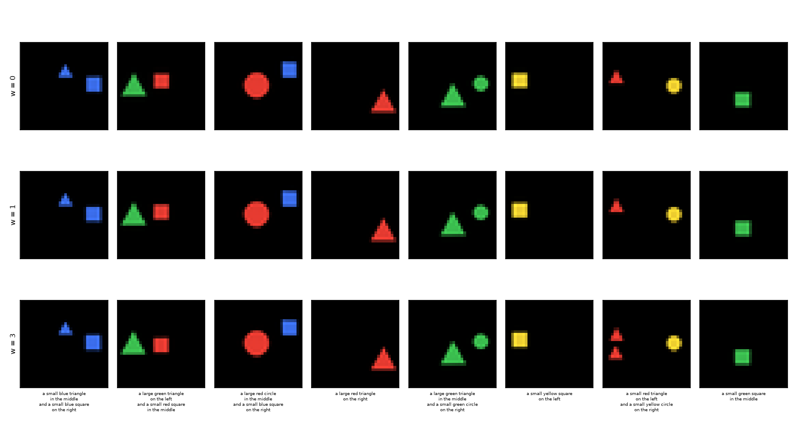
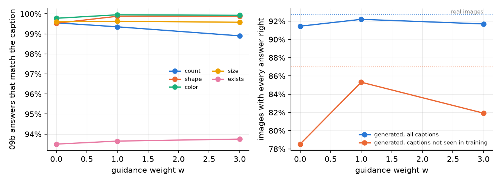

# 09c Text to image

Generate shape scenes from captions, then check the pictures with the models from 09a and 09b.
Generation: flow matching (07) with the U-Net, conditioned on the frozen caption embedding from the 09a CLIP model.

## Math

**Conditional flow matching.** Same straight paths as in 07, now with a caption embedding $c = g(\text{caption})$
from the frozen 09a text encoder:

$$x_t = (1 - t)\, x_0 + t\, x_1, \qquad L = \mathbb E \left\lVert v_\theta(x_t, t, c) - (x_1 - x_0) \right\rVert^2$$

For 10 % of training pairs $c$ is replaced by a learned "no caption" vector $\varnothing$.

**Guidance.** $\tilde v = (1 + w)\, v_\theta(x, t, c) - w\, v_\theta(x, t, \varnothing)$, then 50 Euler steps from noise.

**Checking a picture.** Every caption comes from a known scene, so the right answers are known.

- 09b answers every question about that scene (count; shape, color and size at each position; "Is there a ...?").
  An image counts as fully correct when every answer matches.
- 09a gives the CLIP score: the cosine between the image and caption embeddings.

The checkers are not perfect, so the same checks on real test images give the ceiling.

**Seen and unseen captions.** Most test captions also occur in training. The ones that do not are new combinations
of known words: a test of composition rather than recall.

## Code map

| Math | Code |
|---|---|
| $c$ = frozen 09a caption embedding | `train.py: caption_embeddings`, `model.py: load_clip` |
| $v_\theta(x_t, t, c)$, with $\varnothing$ for dropped captions | `model.py: TextToImage` |
| $\lVert v_\theta(x_t, t, c) - (x_1 - x_0) \rVert^2$ | `objective.py: flow_matching_loss` |
| $(1 + w)\, v(x, c) - w\, v(x, \varnothing)$, Euler steps | `sample.py: generate` |
| questions to 09b, fully-correct images | `sample.py: vlm_check` |
| CLIP score, caption-to-image retrieval | `sample.py: clip_check` |

## Setup

| | |
|---|---|
| Data | 50k training scenes (3 x 32 x 32) with captions |
| Network | the U-Net from `common/nets.py` (3 channels, 32 -> 16 -> 8, attention at 8 x 8), caption embedding added to the time embedding |
| Training | Adam, lr 2e-4, batch 128, 20k steps, EMA 0.999, 10 % captions dropped |
| Sampling | 50 Euler steps, guidance $w$ = 0, 1, 3 |
| Checks | first 2000 test captions (177 of them not in the training set) |

## Run

```
bash 09c_text2image/run.sh          # needs the 09a and 09b runs
python 09c_text2image/figures.py    # figures and table
```

## Checklist

- [x] Text-conditioned flow matching on shape scenes
- [x] Check generated images with the 09b VLM and the 09a CLIP model, against real images
- [x] Guidance, and captions not seen in training

## Results

2000 test captions; 177 of them do not occur in training, all of them three-object scenes
(every one- and two-object caption already appears in the training set).

| Images | Answers right, all | Every answer right, all | Answers right, unseen | Every answer right, unseen | Yes / no, unseen | CLIP score, all |
|---|---|---|---|---|---|---|
| real test images | 0.991 | 0.927 | 0.988 | 0.870 | 0.870 | 0.979 |
| generated, w = 0 | 0.989 | 0.914 | 0.977 | 0.785 | 0.836 | 0.976 |
| generated, w = 1 | 0.990 | 0.922 | 0.985 | 0.853 | 0.881 | 0.978 |
| generated, w = 3 | 0.989 | 0.917 | 0.982 | 0.819 | 0.853 | 0.977 |

- **Generated scenes pass almost as often as real ones.** With $w = 1$, 92.2 % of generated images get every answer right,
  against 92.7 % for real images; the CLIP scores are 0.978 and 0.979. The checker, not the generator, sets most of the
  remaining gap: on real images it misses mostly yes / no questions.
- **New combinations are harder, and guidance helps them most.** On the 177 unseen captions, fully correct images rise
  from 78.5 % ($w = 0$) to 85.3 % ($w = 1$), close to the 87.0 % ceiling, then fall back to 81.9 % at $w = 3$.
- **Too much guidance adds things.** Count accuracy slips as $w$ grows (99.6 % to 98.9 %), and at $w = 3$ some images get
  an extra object (bottom row, seventh column: two red triangles).
- **A closed world.** With 4 colors, 3 shapes, 2 sizes and 3 positions, the model has seen most scenes it is asked for.
  The unseen captions are the only real test of composition, and they are a small set.

### Figures

**Samples from test captions** with guidance $w$ = 0, 1, 3 (same noise in each column).



**Checks by guidance weight.** Left: 09b answers that match the caption, per question type.
Right: images with every answer right; dotted lines are real images.


